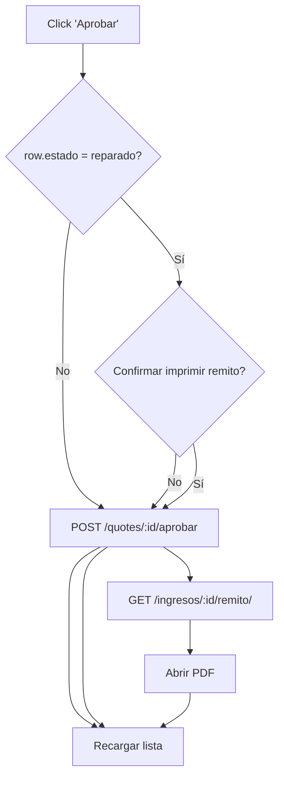

Operativa de remitos y presupuestos

- Pantalla Aprobados (web/src/pages/Aprobados.jsx)
  - Columna removida: “Fecha ingreso”.
  - Botón “Imprimir remito” por fila solo cuando:
    - El estado del ingreso es `reparado`.
    - El usuario tiene rol con permiso de liberar: `jefe`, `jefe_veedor`, `admin` (helper `canRelease`).
  - Acción del botón:
    - Abre `/api/ingresos/:id/remito/` en una nueva pestaña (PDF).
    - Tras imprimir, recarga la lista; el ingreso pasa a `liberado` y puede dejar de mostrarse en Aprobados.

- Confirmación al aprobar presupuesto si el equipo ya está reparado
  - Presupuesto en Hoja de Servicio (web/src/pages/ServiceSheet.jsx)
    - Al hacer “Aprobar presupuesto”, si `estado === "reparado"` se pregunta:
      “Este equipo ya está reparado, ¿imprimir remito de salida?”
    - Si se acepta: se aprueba el presupuesto, se abre el remito en PDF y se refresca el ingreso (queda `liberado`).
    - Si se cancela: solo se aprueba el presupuesto (comportamiento tradicional).
  - Lista de Presupuestados (web/src/pages/Presupuestados.jsx)
    - Al “Aprobar” una fila con `estado === "reparado"`, se muestra la misma confirmación y, al aceptar, se imprime el remito.
    - Luego se actualiza la lista.

- Comportamiento backend al imprimir remito (api/service/views/reportes_views.py)
  - Endpoint: `GET /api/ingresos/<ingreso_id>/remito/` (RemitoSalidaPdfView).
  - Si el ingreso está en `reparado` y la `resolucion` está vacía, se autocompleta `resolucion = 'reparado'` antes de generar el PDF.
  - Si sigue faltando resolución y el estado no es `liberado`, se devuelve 409 (bloquea imprimir).
  - Al imprimir exitosamente, se marca el ingreso como `liberado` (si no estaba `entregado`) y se registra el evento (una sola vez).

- Roles y permisos
  - Frontend (botón en Aprobados): visible solo para `canRelease` → `jefe`, `jefe_veedor`, `admin`.
  - Backend (endpoint remito): permitido a `jefe`, `admin`, `recepcion`, `jefe_veedor`.
    - Nota: por diseño de UI, Recepción no ve el botón en Aprobados. Si se desea, puede agregarse visibilidad también para Recepción.
  - Aprobación de presupuesto: accesible para jefatura (Hoja de Servicio y lista de Presupuestados).

- Versiones del presupuesto (`quotes.version_num`)
  - **Anular no pisa la versión**: la deja como histórica en estado `anulado` -conserva fecha de emisión, fecha de aprobación, PDF e ítems- y crea una copia en `pendiente` (con `origen_quote_id` apuntando a la anulada) que es la que se edita y se reemite. El PDF sale titulado `OS 000NN-<versión>`.
  - Si la versión anulada estaba aprobada, además se devuelve el stock de los repuestos y el ingreso vuelve de `reparar` a `diagnosticado`.
  - El otro camino a una versión nueva es **rechazar** y después "Nuevo presupuesto" (`POST /api/quotes/<id>/versiones/`).
  - `anulado` es un valor del enum `quote_estado`. Lo agrega `apply_quote_anulacion_schema`, que corre solo en el arranque del contenedor vía `prepare_production_schema`: tiene que estar commiteado antes de que la app lo escriba, porque con `ATOMIC_REQUESTS` PostgreSQL no deja usar un valor de enum recién agregado en la misma transacción.
  - Pendiente: editar una versión **ya emitida** la sigue modificando en el lugar (no abre una versión nueva), así que cambian los importes del presupuesto que el cliente ya recibió.

- Sincronización de estado por trigger (sql/schema.sql)
  - Cuando la `quote` cambia de estado a `aprobado`, el trigger `sync_quote_with_ingreso` actualiza `presupuesto_estado` y, si el estado actual del ingreso es uno de `ingresado/diagnosticado/presupuestado`, pasa a `reparar`.
  - Si el equipo ya estaba `reparado`, el trigger conserva el estado actual (no lo retrocede).

- Aviso a Cobranzas cuando el equipo es un MG propio
  - Al aprobar el presupuesto de un equipo propio de MG BIO, Cobranzas recibe un correo con el **PDF del presupuesto adjunto** y un resumen (OS, versión, N° interno MG, N/S, marca/modelo, cliente de la orden, neto/IVA/total y quién aprobó).
  - Sólo aplica a los **MG vigentes del patrimonio**. Los MG históricos (vendidos: `mg_estado='inactivo_venta'` o con datos de venta cargados) no disparan el aviso. El corte lo decide `ingreso_is_internal_equipment` (`api/service/bejerman_sync.py`), el mismo gate que usa la transferencia de stock STR→STL.
  - Es un aviso **sólo de correo**: no genera campana. Tipo `presupuesto_mg_aprobado`, grupo "Cobranzas" del centro de notificaciones; por defecto lo reciben los usuarios con rol `cobranzas` y se apaga desde ahí con el toggle "Mail".
  - Sale por la cola de correos (`notification_email_outbox`), así que el PDF se genera en el worker `email-outbox` y no dentro del request de aprobación. Si el PDF fallara, el correo igual sale con el resumen y el link.
  - Sólo lo dispara la aprobación interna (Hoja de Servicio y lista de Presupuestados). La aprobación desde el Portal Cliente no lo emite.
  - Implementación: `api/service/quote_mg_notifications.py`, enganchado al final de `AprobarPresupuestoView` (`api/service/views/quotes_views.py`).

- Consideraciones de UX/errores
  - Si la apertura del PDF falla, se muestra un error y el usuario puede intentar imprimir luego desde la hoja de servicio o desde Aprobados.
  - Tras imprimir, la Hoja de Servicio se refresca (cuando aplica) para reflejar el paso a `liberado`.

- Referencias rápidas (archivos)
  - Aprobados: `web/src/pages/Aprobados.jsx`
  - Hoja de Servicio (Presupuesto): `web/src/pages/ServiceSheet.jsx`
  - Presupuestados (lista): `web/src/pages/Presupuestados.jsx`
  - Endpoint remito: `api/service/views/reportes_views.py`
  - Trigger de sincronización: `sql/schema.sql`

## Diagramas de flujo

### Aprobados: botón “Imprimir remito”
```mermaid
flowchart TD
  A[Usuario con rol liberar<br/>(jefe/jefe_veedor/admin)] --> B{Fila estado = reparado?}
  B -- No --> Z[No mostrar botón]
  B -- Sí --> C[Click 'Imprimir remito']
  C --> D[GET /api/ingresos/:id/remito/]
  D --> E{resolución vacía y estado reparado?}
  E -- Sí --> F[SET resolucion='reparado']
  E -- No --> G
  F --> G{resolución presente o estado liberado?}
  G -- No --> H[409: falta resolución]
  G -- Sí --> I[UPDATE estado='liberado' + registrar evento]
  I --> J[Generar PDF]
  J --> K[Frontend abre PDF y refresca lista]
```

### Hoja de Servicio (Presupuesto): aprobar + imprimir si ya está reparado
```mermaid
flowchart TD
  A[Click 'Aprobar presupuesto'] --> B{estado actual = reparado?}
  B -- No --> C[POST /quotes/:id/aprobar] --> D[Actualizar estado presupuesto] --> X[Fin]
  B -- Sí --> E{Confirmar imprimir remito?}
  E -- No --> C
  E -- Sí --> C --> F[GET /ingresos/:id/remito/]
  F --> G[Abrir PDF] --> H[Refrescar ingreso (pasa a liberado)]
```

### Presupuestados (lista): aprobar + imprimir si ya está reparado

